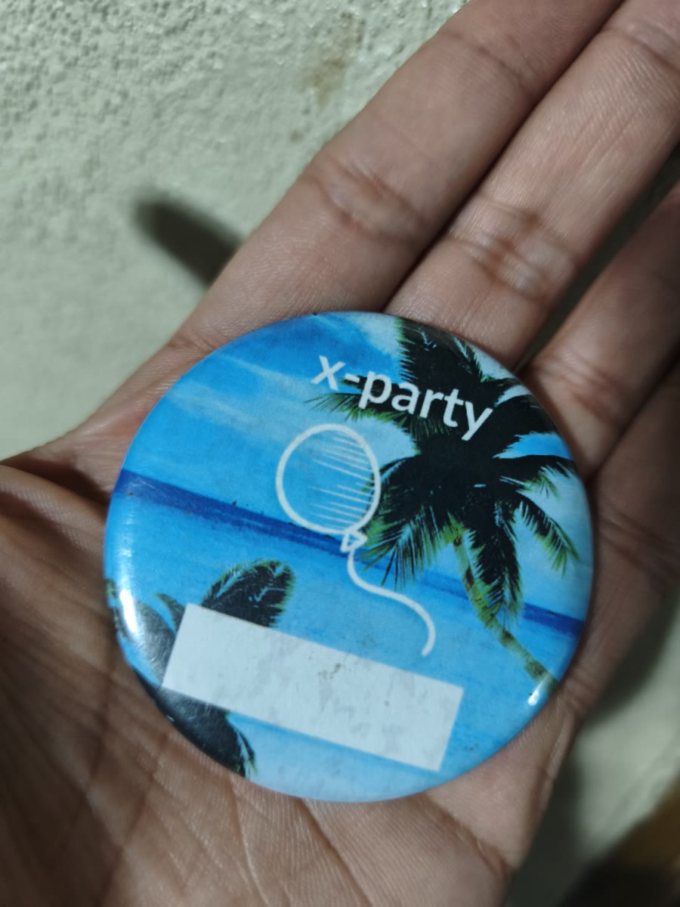

**Je suis passé par quatre pseudos : Kris7Pivot, Xentyo, Ricexen et RiceSeed(x).** Chacun a marqué une étape : animer des bonshommes en Pivot, monter des [AMV](https://fr.wikipedia.org/wiki/Anime_music_video) sous Sony Vegas, chercher le zen dans le riz et prévoir des chaînes avec mes deux petites mains.

Voici comment je suis arrivé de Kris7Pivot à RiceSeed(x), preuve encore visible : le [bouclier K7P que j'ai dessiné en 2011](mis-creaciones-2011#escudo-k7p).

🔒 TL;DR pour Ulises: une question pour débloquer

Quel est le pseudo du membre d'équipage NT qui adore les jeux Pokémon ?

<input class="puzzle-input" type="text" placeholder="pseudo" autocomplete="off" aria-label="Réponse" />
<button class="puzzle-btn" type="button">Débloquer</button>

<strong>TL;DR pour Ulises :</strong> je sais que tu vas dire "trop long", voilà le résumé : <strong>Kris7Pivot</strong> animait des bâtonnets sur Pivot (2010) → <strong>Xentyo</strong> est né du Centello raccourci au minimum et montait des AMV sous Sony Vegas (2012-2016) → <strong>Ricexen</strong> c'était le riz zen + le vestige <code>xen</code> de Xentyo → <strong>RiceSeed(x)</strong> c'est la graine et garde le <code>x</code>. Pour la version complète, continue.

<noscript><blockquote><strong>TL;DR pour Ulises :</strong> je sais que tu vas dire "trop long", voilà le résumé : <strong>Kris7Pivot</strong> animait des bâtonnets sur Pivot (2010) → <strong>Xentyo</strong> est né du Centello raccourci au minimum et montait des AMV sous Sony Vegas (2012-2016) → <strong>Ricexen</strong> c'était le riz zen + le vestige <code>xen</code> de Xentyo → <strong>RiceSeed(x)</strong> c'est la graine et garde le <code>x</code>. Pour la version complète, continue.</blockquote></noscript>

🎧 Note vocale : Comment je suis passé de Kris7Pivot à RiceSeed(x)

L'enregistrement original, ~11 min à raconter l'histoire telle que sortie de l'enregistreur : Pivot, AMV sous Sony Vegas, riz zen et le sac de Rosarito.

<audio controls preload="none" style="width: 100%;">
  <source src="../assets/nota-voz-nicknames.opus" type="audio/opus" />
  <source src="../assets/nota-voz-nicknames.mp3" type="audio/mpeg" />
  Votre navigateur ne supporte pas l'audio. <a href="../assets/nota-voz-nicknames.opus">Télécharger OPUS (1,9 Mo)</a> / <a href="../assets/nota-voz-nicknames.mp3">MP3 (2,5 Mo)</a>
</audio>

## Avant les pseudos : des bâtonnets qui se battent

Mes premières interactions avec internet, c'étaient des animations grotesques que presque tout le monde a vues. J'essayais de les éviter et elles arrivaient quand même : Mario dans GTA, Mario contre Goku en sprite sheets et tous les bonshommes qui se battent.

Du coup, la première chose que j'ai faite quand on a eu internet à la maison, c'était d'essayer d'animer. Le logiciel que j'ai eu, c'était Pivot Stick Figure Animator, et franchement c'était trop cool.

## Kris7Pivot a été ma première signature

Pivot m'a donné mon premier pseudo : Kris7Pivot, abrégé K7P. Même mon premier hotmail, je l'ai fait avec ce nom, et je l'ai gardé longtemps. Il en reste une preuve : mon [combat Naruto vs Sasuke animé sur Pivot](https://www.youtube.com/watch?v=-4TvcvWn62w) de 2010, uploadé depuis le compte qui s'appelle encore kris7pivot.

<video controls preload="none" src="../assets/naruto-vs-sasuke-pivot.mp4" poster="../assets/naruto-vs-sasuke-pivot.jpg" title="Naruto vs Sasuke animé sur Pivot par kris7pivot" style="width:100%; max-height:600px; border-radius:4px;"></video>

*Si tu veux laisser une vue au petit RiceSeed, [clique ici](https://www.youtube.com/watch?v=-4TvcvWn62w).*

Je l'ai lâché au lycée, quand on commence à te demander un mail plus pro. Selon eux, ils te font transitionner vers le monde adulte, donc tu t'adaptes.

## Xentyo est né du Centello en mode minimaliste

Les AMV bougeaient déjà de mon côté avant le nom. C'étaient des vidéos entre romantiques, pour exprimer ce que je ressentais, sans en faire trop. Celle avec True Tears date de 2012, encore signée kris7pivot :

<iframe src="https://www.youtube-nocookie.com/embed/AdhorUhxlAE" style="position:absolute;top:0;left:0;width:100%;height:100%;border:0;" title="AMV True Tears par kris7pivot" allow="accelerometer; autoplay; clipboard-write; encrypted-media; gyroscope; picture-in-picture" allowfullscreen loading="lazy" referrerpolicy="strict-origin-when-cross-origin"></iframe>

À cette époque je montais sous Sony Vegas, ce qui était entre crackable et utilisable : le reste venait avec des virus ou l'antivirus le tuait.

Là j'ai appris un effet qui s'appelait Centello : il faisait briller les points de lumière, comme des halos autour de chaque lampe. Le [tuto Centello que j'ai suivi](https://youtu.be/br8MgSCSezU?t=21) l'explique mieux que moi.

<iframe src="https://www.youtube-nocookie.com/embed/br8MgSCSezU?start=21" style="position:absolute;top:0;left:0;width:100%;height:100%;border:0;" title="Tuto effet Centello sous Sony Vegas" allow="accelerometer; autoplay; clipboard-write; encrypted-media; gyroscope; picture-in-picture" allowfullscreen loading="lazy" referrerpolicy="strict-origin-when-cross-origin"></iframe>

Et comme j'étais à fond dans le minimalisme à cause de Steve Jobs, je l'ai raccourci au max :

- Centello → Centeyo → Centyo → Xentyo

Mon plus grand accomplissement en tant que créateur, ça a été d'entrer dans un collab en 2015. Voici mon track :

<iframe src="https://www.youtube-nocookie.com/embed/R2E6nnGl_So" style="position:absolute;top:0;left:0;width:100%;height:100%;border:0;" title="Mon track pour le collab Dark Zone Dreams" allow="accelerometer; autoplay; clipboard-write; encrypted-media; gyroscope; picture-in-picture" allowfullscreen loading="lazy" referrerpolicy="strict-origin-when-cross-origin"></iframe>

Voilà le [collab complet, ma partie commence à 3:30](https://youtu.be/4xqVF314b4k?t=210).

Puis est venu Anohana, en 2016.

<video controls preload="none" src="../assets/anohana-before-of-the-story.mp4" poster="../assets/anohana-before-of-the-story.jpg" title="AMV Before of the Story, Anohana, par Xentyo AMV" style="width:100%; max-height:600px; border-radius:4px;"></video>

J'ai gardé ce nom presque tout le temps, jusqu'au milieu de la fac.

## Xentyo est mort dans un sac à dos à Rosarito

Deux choses ont tué Xentyo. Une rupture amoureuse m'a donné envie d'oublier plusieurs trucs de l'époque, et de chercher un mode plus zen et tranquille.

L'autre était pratique : lors d'un voyage universitaire pour camper près de Rosarito, on a laissé nos téléphones dans un sac à dos, on nous l'a volé et je me suis retrouvé sans téléphone. Tout était lié à ce numéro en double facteur, y compris le Gmail de la chaîne. J'ai passé des années sans me connecter ; je l'ai récupéré il y a moins de deux ans.

<figure style="margin:1.5em auto; max-width:420px;">

<figcaption style="font-size:0.8rem; color:var(--text-faint); text-align:center; margin-top:4px;">Souvenir du voyage à Rosarito où j'ai perdu l'accès à la chaîne. Le pin était pour écrire ton prénom et faire connaissance, mais non, ça n'a pas marché</figcaption>
</figure>

## Ricexen, c'était le mode zen, puis le processeur

Le nom suivant est venu de vouloir externaliser une autre part de ma personnalité. J'ai fait ma grosse recherche et j'ai choisi le riz : l'aliment le plus simple qui existe, presque que de l'amidon et des glucides. Rice plus `xen` : ça sonnait zen, le mode que je cherchais, et c'était le vestige de Xentyo.

Environ 7 ou 8 mois plus tard, la marque de processeurs Ryzen est devenue populaire et j'ai aimé la coïncidence. C'était l'alternatif qui faisait les choses différemment face à Intel, et j'aimais cette façon de se battre sur le marché.

Avec le temps les modes ont tourné et Ricexen est passé de l'épicentre du "bien faire" à l'autre côté. Pour m'en défaire j'ai tout poussé vers des chaînes YouTube et podcast.

## RiceSeed(x) garde le x comme vestige

RiceSeed, c'est la graine de riz, et le `(x)` est le vestige de Xentyo qui a survécu à deux morts. C'est encore le nom actuel.

Kris7Pivot animait. Xentyo montait. Ricexen pensait. RiceSeed sème.

On dit que changer de pseudo, c'est une crise d'identité. Moi je dis que c'est déménager : même personne, autre chaîne, comme je ne peux pas déménager dans le monde physique, c'est le max que je peux faire.

Le truc marrant, c'est que Kris7Pivot est toujours vivant : sa chaîne, sa vidéo de 2010, son bouclier de 2011. Je ne l'ai pas tué, j'ai juste arrêté de signer comme ça. Tous mes pseudos sont encore là, comme de vieilles maisons où je peux revenir... ou pas.

Mon meilleur moment, ça a été un track de 23 secondes dans le collab d'un autre. Après ça, il n'y avait plus rien à prouver : les noms qui ont suivi, c'était pour m'ordonner la vie, pas pour qu'on me voie.

Mais bon, je vais continuer à grandir, et je vais probablement continuer à changer de nom. Ça m'énerve en partie d'avoir tout éparpillé, mais déménager et laisser des choses derrière me rend aussi plus libre.

Ce que j'ai toujours cherché au fond : porter la liberté où que j'aille, que ce soit dans le temps ou dans le monde physique. J'espère bientôt déménager dans le monde physique.
